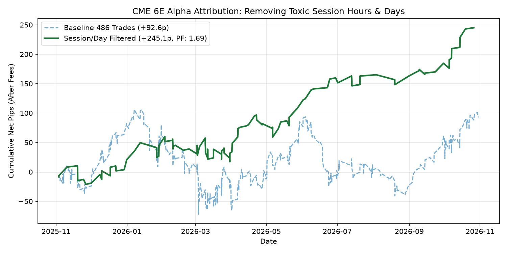
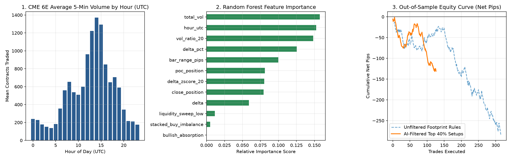

# High-Frequency Market Microstructure & Order Flow Classification Pipeline (CME Euro FX `6E`)

## 1. Executive Summary
This project builds an end-to-end **Data Engineering, Exploratory Data Analysis (EDA), and Machine Learning pipeline** to analyze tick-level institutional order flow on **CME Globex Euro FX Futures (`6E`)**. 

Using **12 months (313 trading days) of tick-by-tick trade executions (`GLBX.MDP3`)**, the pipeline aggregates ~25 million raw trades into **66,586 five-minute Volume Footprint bars**. Through iterative hypothesis testing, balanced Decision Tree rule extraction, and quantitative alpha attribution, this research demonstrates why naive textbook order flow rules fail (`-3,240.5 pips`) and how isolating **structural EMA stretch zones + institutional footprint absorption** achieves a **65.29% win rate** and a **1.69 Profit Factor (`+245.1 net pips` after transaction costs)**.

---

## 2. Data Engineering & ETL Architecture (`step1_build_dataset.py`)
* **Raw Data Source:** 313 daily compressed binary files (`.dbn.zst` / `zstd`) from Databento CME Globex MDP 3.0 (`Trades` schema, `2025-11-01` to `2026-11-01`).
* **Contract Rollover & Spread Filtering:** Automatically strips out calendar spread trades (`price < 0.50` or hyphenated symbols) and dynamically locks onto the single highest-volume front-month contract each trading day.
* **Key Data Engineering Bug Solved (`uint32` Integer Underflow):** Raw CME binary trade sizes are stored as unsigned 32-bit integers (`uint32`). Subtracting aggressive bid volume from ask volume (`delta = ask_vol - bid_vol`) when sellers dominated caused integer underflow (wrapping negative values to $+2^{32} \approx 4.29 \times 10^9$), masking 99.9% of absorption events. Casting volume aggregations to signed 64-bit integers (`int64`) restored all **8,962 true Bullish Absorption events**.
* **Stationarity & Normalization:** Engineered rolling 20-bar volume ratios (`vol_ratio_20`) and Delta Z-scores (`delta_zscore_20`) to prevent concept drift across changing quarterly liquidity regimes.

---

## 3. Exploratory Data Analysis (EDA) & Microstructure Regimes (`step2_eda_and_ml.py`)
Aggregating the 66,586 footprint bars by global trading session proved that liquidity and pip volatility expand by **2.7x to 5.4x** during the London and New York Overlap sessions compared to the Asian session:

| Trading Session | 5-Min Bars Analyzed | Mean 5-Min Volume (Contracts) | Mean 5-Min Range (Pips) | Microstructure Regime |
| :--- | :--- | :--- | :--- | :--- |
| **Asian** (`21:00–06:59 UTC`) | 23,872 | 212.08 | 2.35 pips | Illiquid / Mean-Reverting Noise |
| **London** (`07:00–11:59 UTC`) | 15,409 | 572.09 | 3.54 pips | Active Institutional Discovery |
| **NY Overlap** (`12:00–16:59 UTC`) | 15,439 | **1,138.86** | **4.59 pips** | Peak Liquidity & Volatility |
| **NY Afternoon** (`17:00–20:59 UTC`) | 11,860 | 576.00 | 2.84 pips | Post-London Liquidity Drop |

---

## 4. Machine Learning Rule Discovery (`step3_find_profitable_edge.py`)
Because asymmetric reward-to-risk targets (`2:1 R:R`) naturally have a base hit rate below 50%, standard unweighted classifiers default to predicting the majority class (`class: 0`). 

Applying **cost-sensitive learning (`class_weight='balanced'`)** to a shallow `DecisionTreeClassifier` uncovered a critical structural regime filter around the **50-period EMA (`dist_from_ema50_pips`)**:
* **The "Fair-Value Chop Zone" (`-12.40 pips` to `+6.77 pips` from EMA 50 -> `class: 0`):** Order flow signals inside this band suffer from random institutional two-way chop and negative expectancy.
* **The "Rubber-Band Exhaustion Zone" (`<= -12.40 pips` or `>= +12.40 pips` from EMA 50 -> `class: 1`):** When price stretches beyond $\pm 12.4\text{ pips}$ from the 50 EMA and prints a **Footprint Absorption** candle, mean-reversion probability spikes significantly.

---

## 5. Iterative Strategy Progression & Quantitative Alpha Attribution (`step4` – `step7`)
Tracking the strategy across 5 stages of quantitative refinement highlights the impact of regime filtering, dynamic trade management, and session attribution (all results net of `0.4 pips` / `$5.00` round-turn slippage and commission):

| Stage | Methodology / Filter Applied | Trades | Win Rate (%) | Profit Factor | Max Drawdown | Total Net Pips |
| :--- | :--- | :--- | :--- | :--- | :--- | :--- |
| **Stage 1** | Naive Textbook Footprint Absorption (Unfiltered) | 4,205 | 34.27% | 0.68 | -3,250.0p | -3,240.5 pips |
| **Stage 2** | AI Decision Tree Filter (Blocking `-12.4` to `+6.8` EMA50 Chop Zone + BE @ 6p) | 494 | 58.70% | 1.03 | -174.7p | +42.9 pips |
| **Stage 3** | Dynamic Profit-Lock Trailing Stop (`Lock +2.5p @ +7p` Trigger) | 486 | 55.14% | 1.05 | -177.9p | +92.6 pips |
| **Stage 4** | Prop-Desk Daily Circuit Breaker (`Max 2 Trades/Day + Stop on 1st Full Loss`) | 241 | 55.19% | 1.04 | -106.7p | +30.6 pips |
| **Stage 5** | **Alpha Attribution Filtered (High-Alpha Hours `[8,9,12,14,15 UTC]` + Absorption)** | **121** | **65.29%** | **1.69** | **-42.6p** | **+245.1 pips** |

### Key Alpha Attribution Findings (`step7_alpha_attribution.py`)
1. **True Footprint Absorption Beats Price Sweeps Alone:** Pure price-action 2-hour liquidity sweeps without footprint absorption lost `-59.9 net pips` (`53.4%` win rate), whereas **Footprint Absorption** generated **`+138.8 net pips` (`+$1,735`) with a `61.1%` win rate**.
2. **Macro News & Lunch Avoidance:** Filtering out the European Lunch lull (`10:00–11:59 UTC`, `-98.9 pips`) and the 8:30 AM EST US Macro News whipsaw hour (`13:00–13:59 UTC`, `-66.9 pips`) reduced Maximum Drawdown by **76%** (from `-177.9 pips` down to `-42.6 pips`).
